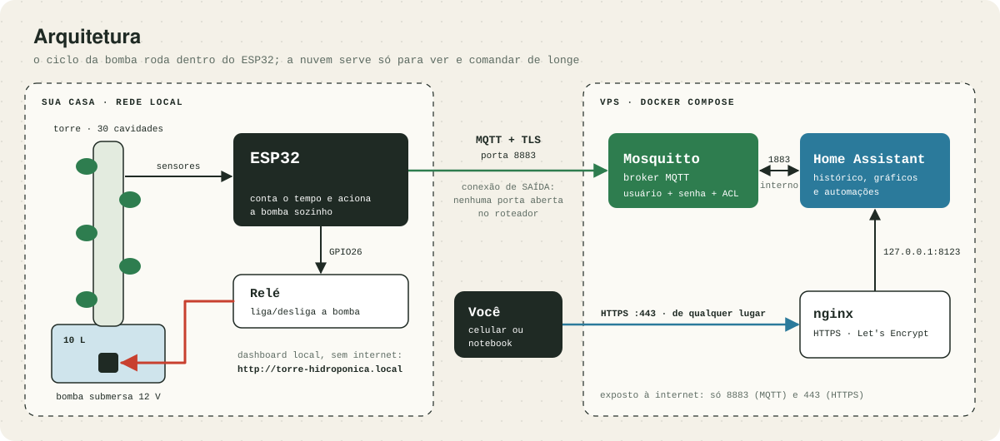
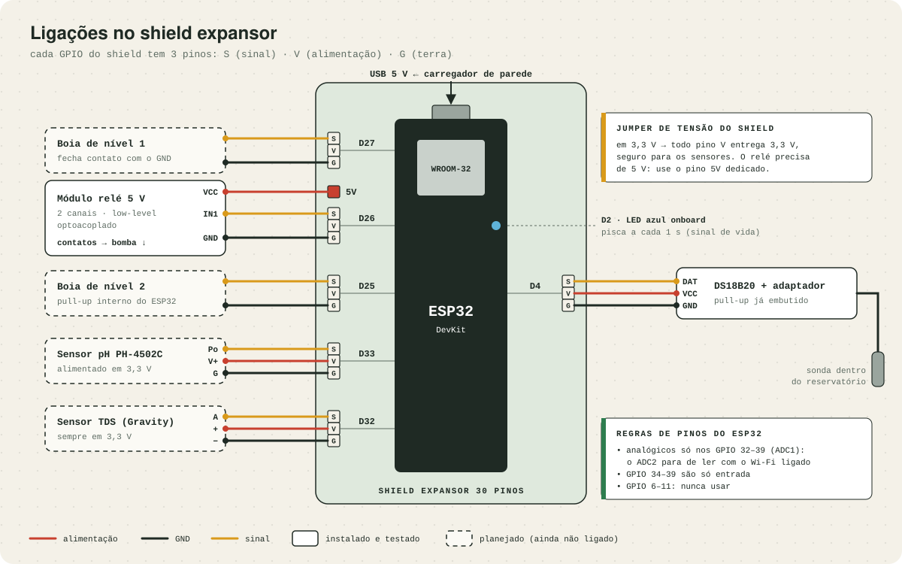
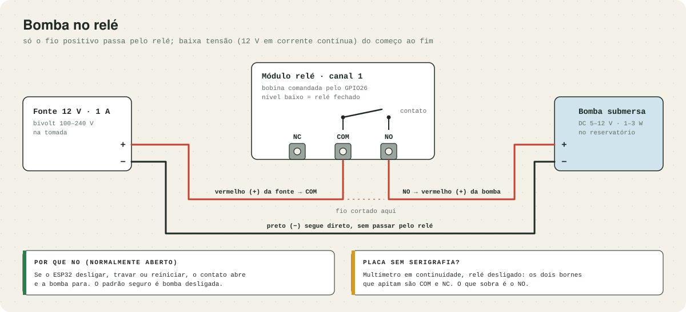
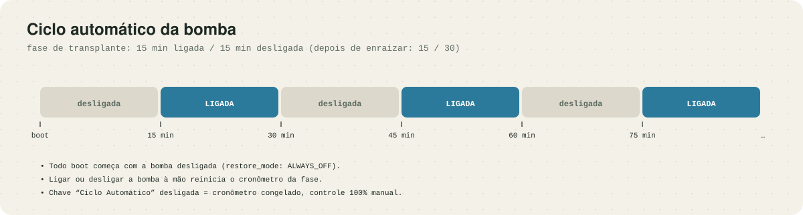

# Torre hidropônica automatizada com ESP32

Automação de uma torre hidropônica caseira (30 cavidades, reservatório de 10 L) com um **ESP32**, **ESPHome** e, opcionalmente, **Home Assistant** numa VPS. O ESP32 liga e desliga a bomba em ciclos, lê sensores da água e pode ser acompanhado pelo celular de qualquer lugar.

Este repositório tem tudo o que uso na minha torre: o firmware, os diagramas de ligação, a configuração do servidor e uma simulação para testar sem hardware. Se você quer montar algo parecido, dá para seguir daqui.



## Sumário

- [O que ele faz](#o-que-ele-faz)
- [O que já funciona e o que falta](#o-que-já-funciona-e-o-que-falta)
- [Lista de materiais](#lista-de-materiais)
- [Parte física](#parte-física)
- [Firmware](#firmware)
- [Home Assistant numa VPS (opcional)](#home-assistant-numa-vps-opcional)
- [Simulação no Wokwi](#simulação-no-wokwi)
- [Lições que custaram tempo](#lições-que-custaram-tempo)
- [Estrutura do repositório](#estrutura-do-repositório)
- [Cultivo](#cultivo)

## O que ele faz

- **Irriga sozinho.** O ESP32 conta o tempo e aciona a bomba em ciclos (15 min ligada / 15 min desligada na fase de transplante). O ciclo roda dentro do próprio ESP32: se a internet ou o servidor caírem, a irrigação continua.
- **Mostra um painel local.** O ESP32 serve um dashboard em `http://torre-hidroponica.local`, protegido por usuário e senha, com o estado da bomba, a contagem regressiva da fase e chaves para controle manual.
- **Pode ser acompanhado de fora de casa.** O ESP32 publica tudo por MQTT com TLS num broker Mosquitto. Um Home Assistant ao lado do broker guarda histórico e permite comandar pelo celular.
- **Não abre porta no roteador.** A conexão sempre parte do ESP32 para o servidor.
- **Atualiza pelo Wi-Fi.** Depois da primeira gravação por USB, as seguintes vão por OTA.

## O que já funciona e o que falta

| Parte | Situação |
|---|---|
| Bomba no relé + ciclo automático | ✅ em uso |
| Dashboard local com senha | ✅ em uso |
| MQTT com TLS + Home Assistant na VPS | ✅ em uso |
| Temperatura da água (DS18B20) | ✅ testado; no momento desconectado na minha montagem por falta de jumpers |
| Sensor TDS (concentração de nutrientes) | ⏳ configuração pronta e comentada no firmware; a primeira placa veio com defeito |
| Sensor de pH (PH-4502C) | ⏳ planejado, ainda não ligado |
| Boias de nível do reservatório | ⏳ planejado, ainda não ligado |

O que está marcado como planejado aparece tracejado nos diagramas. Trate essas partes como ponto de partida, não como receita testada.

## Lista de materiais

| Item | Para que serve | Observação |
|---|---|---|
| ESP32 DevKit WROOM-32 (30 pinos) | cérebro | com os pinos já soldados |
| Shield expansor para ESP32 de 30 pinos | dispensa protoboard | cada GPIO vira três pinos S·V·G |
| Módulo relé 5 V, 2 canais, optoacoplado | liga e desliga a bomba | o meu aciona em nível baixo (*low-level trigger*) |
| Bomba submersa DC 5–12 V, 1–3 W | circula a solução | veio com a torre |
| Fonte 12 V / 1 A | alimenta a bomba | veio com a torre |
| Carregador USB 5 V + cabo de dados | alimenta o ESP32 | o cabo precisa ser de dados para a primeira gravação |
| DS18B20 à prova d'água + módulo adaptador | temperatura da água | o adaptador já tem o resistor de pull-up |
| Jumpers fêmea-fêmea | ligar os módulos ao shield | compre um pacote de 40; eles acabam rápido |
| Multímetro simples | identificar bornes e conferir tensões | qualquer modelo básico |
| Caixa estanque (~20×20×9 cm) | abrigar a eletrônica | fica perto de água |
| *Sensor TDS (Gravity)* | concentração de nutrientes | planejado |
| *Sensor de pH PH-4502C + eletrodo BNC* | pH da solução | planejado; precisa das soluções de calibração 4,01 e 6,86 |
| *2 boias de nível magnéticas* | avisar reservatório baixo | planejado |

## Parte física

### Ligações no shield

O shield replica cada GPIO do ESP32 em três pinos: **S** (sinal), **V** (alimentação) e **G** (terra). Cada módulo vai com três jumpers fêmea-fêmea, sem protoboard e sem solda.



No desenho, os três pinos de cada GPIO aparecem empilhados para os fios não se cruzarem. No shield de verdade eles ficam lado a lado, e a ordem muda de fabricante para fabricante: **confira a serigrafia do seu**.

| GPIO | O que liga | Detalhe |
|---|---|---|
| GPIO2 | LED azul da própria placa | pisca a cada 1 s como sinal de vida |
| GPIO4 | DS18B20 (1-Wire) | DAT → S, VCC → V, GND → G |
| GPIO26 | Relé, entrada IN1 | IN1 → S, GND → G, **VCC no pino 5V dedicado do shield** |
| GPIO32 | TDS (analógico) | sempre em 3,3 V |
| GPIO33 | pH (analógico) | ver a ressalva abaixo |
| GPIO25 e GPIO27 | boias de nível | uma ponta no S, a outra no G; o pull-up é o interno do ESP32 |

Três cuidados antes de ligar qualquer coisa:

1. **Jumper de tensão do shield em 3,3 V.** Assim todo pino V entrega 3,3 V, que é o máximo que as entradas do ESP32 aguentam. O relé é a exceção: a bobina precisa de 5 V, então o VCC dele vai no pino 5V dedicado.
2. **Sensores analógicos só nos GPIO 32 a 39.** Esses pertencem ao ADC1. Os outros pinos analógicos (ADC2) param de ler quando o Wi-Fi está ligado.
3. **GPIO 34 a 39 são só entrada, e GPIO 6 a 11 não podem ser usados** (estão ligados à memória flash da placa).

**Ressalva sobre o pH.** O PH-4502C foi feito para 5 V, e a saída dele pode passar de 3,3 V, o que queima a entrada do ESP32. Há dois caminhos: alimentar o módulo em 5 V e baixar a saída com um divisor de tensão (10 kΩ e 20 kΩ, compensando ×1,5 no firmware), ou alimentá-lo em 3,3 V e ligar direto, aceitando menos resolução. Meu plano é o segundo, mas **ainda não testei**.

### Bomba no relé

A bomba é de 12 V em corrente contínua, então tudo aqui é baixa tensão. O relé interrompe só o fio positivo: corte o fio vermelho entre a fonte e a bomba, ligue a ponta que vem da fonte no borne **COM** e a ponta que vai para a bomba no borne **NO**. O fio preto segue direto.



- **Use o NO (normalmente aberto), não o NC.** Com o ESP32 desligado, travado ou reiniciando, o contato fica aberto e a bomba para.
- **Módulo sem identificação nos bornes?** Com o relé desligado, use o multímetro em continuidade: os dois bornes que apitam são COM e NC, e o que sobra é o NO. No meu, o COM é o do meio.
- **Relé de nível baixo.** O meu módulo fecha o contato quando o pino vai a 0 V. Por isso o firmware usa `inverted: true` no GPIO26. Se o seu aciona em nível alto, remova essa linha.
- **Não use este esquema para 110/220 V sem saber o que está fazendo.** Tensão de rede exige relé e fiação adequados, isolamento e, de preferência, alguém habilitado.

### Onde fica a eletrônica

Guarde a eletrônica numa caixa estanque, fora do alcance de respingos, com os cabos entrando por baixo. A sonda do DS18B20 e a bomba são as únicas partes que ficam na água.

## Firmware

O firmware é um único arquivo YAML do [ESPHome](https://esphome.io): [`esphome/torre.yaml`](esphome/torre.yaml). Não há código C++ para compilar à mão.

### Primeira gravação

```bash
# 1. Instale o ESPHome (macOS: brew install esphome)
pip install esphome

# 2. Crie o arquivo de segredos a partir do modelo e preencha
cd esphome
cp secrets.example.yaml secrets.yaml

# 3. Com o ESP32 no cabo USB, compile e grave
esphome run torre.yaml
```

O `secrets.yaml` guarda o Wi-Fi, a chave da API, as senhas do OTA e do dashboard e os dados do MQTT. Ele está no `.gitignore` e **nunca deve ir para o repositório**. Para gerar a chave da API: `openssl rand -base64 32`.

Da segunda vez em diante, a gravação vai pelo Wi-Fi:

```bash
esphome run torre.yaml --device torre-hidroponica.local
esphome logs torre.yaml --device torre-hidroponica.local   # logs ao vivo
```

Se você não for usar o MQTT, apague o bloco `mqtt:` do `torre.yaml`. O resto funciona sozinho.

### Como o ciclo funciona



As durações ficam no topo do `torre.yaml`, em segundos:

```yaml
substitutions:
  fase_ligada_s: "900"      # 15 min
  fase_desligada_s: "900"   # 15 min; depois do enraizamento uso "1800"
```

No dashboard aparecem:

| Entidade | O que é |
|---|---|
| **Rele Bomba** | liga e desliga a bomba à mão (a troca reinicia o cronômetro da fase) |
| **Ciclo Automatico** | chave mestra; desligada, o cronômetro congela e o controle fica manual |
| **Status da Bomba** | texto do tipo "Ligada - desliga em 7 min" |
| **Tempo Ligado** | segundos desde o último boot; serve para flagrar reinícios inesperados |
| **Temperatura da Agua** | leitura do DS18B20 |

### Segurança do firmware

- **API nativa** com chave de criptografia.
- **OTA** com senha.
- **Dashboard** com usuário e senha.
- **MQTT** só por TLS, validando o certificado do servidor (`skip_cert_cn_check: false`).

Sem isso, qualquer aparelho na sua rede Wi-Fi poderia ligar a bomba ou regravar o ESP32.

## Home Assistant numa VPS (opcional)

Rodar o Home Assistant no computador de casa funciona, mas o computador precisa ficar ligado. Movi o meu para uma VPS pequena (ele usa algumas centenas de MB de RAM). Como a VPS não enxerga o ESP32 dentro de casa, é o ESP32 que se conecta a ela, por MQTT.

Os arquivos estão em [`vps/`](vps/). Onde aparece `__DOMINIO__`, troque pelo seu domínio. Um subdomínio gratuito do [DuckDNS](https://www.duckdns.org) apontando para o IP da VPS resolve.

```bash
# Na VPS (Ubuntu com Docker, nginx e certbot instalados)
mkdir -p /opt/torre/{homeassistant,mosquitto/config,mosquitto/data,mosquitto/certs}
cp docker-compose.yml /opt/torre/
cp mosquitto/mosquitto.conf mosquitto/acl /opt/torre/mosquitto/config/
cp homeassistant/configuration.yaml /opt/torre/homeassistant/
cd /opt/torre/homeassistant && echo '[]' > automations.yaml && touch scripts.yaml scenes.yaml

# Usuários do broker: um para o Home Assistant, outro para o ESP32
touch /opt/torre/mosquitto/config/passwd
docker run --rm -v /opt/torre/mosquitto/config:/c eclipse-mosquitto:2 \
  sh -c "mosquitto_passwd -b /c/passwd homeassistant 'SENHA_1' && mosquitto_passwd -b /c/passwd torre-esp 'SENHA_2'"
chown -R 1883:1883 /opt/torre/mosquitto
chmod 700 /opt/torre/mosquitto/config/passwd /opt/torre/mosquitto/config/acl

# Sobe os dois containers. O Home Assistant fica só em 127.0.0.1:8123.
# O Mosquitto reinicia em loop até receber o certificado, mais abaixo.
cd /opt/torre && docker compose up -d
```

**Crie a conta do Home Assistant antes de publicá-lo.** Na primeira visita ele deixa qualquer pessoa criar o usuário administrador. Faça isso por um túnel SSH, com o serviço ainda fechado para a internet:

```bash
ssh -L 8123:127.0.0.1:8123 root@IP_DA_VPS    # e abra http://localhost:8123
```

Depois publique com HTTPS e entregue o certificado ao Mosquitto:

```bash
sed 's/__DOMINIO__/seu.dominio/' nginx/torre.conf > /etc/nginx/sites-available/torre
ln -s /etc/nginx/sites-available/torre /etc/nginx/sites-enabled/
certbot --nginx -d seu.dominio --redirect

sed 's/__DOMINIO__/seu.dominio/' certbot-deploy-hook.sh > /etc/letsencrypt/renewal-hooks/deploy/torre-mosquitto.sh
chmod +x /etc/letsencrypt/renewal-hooks/deploy/torre-mosquitto.sh
RENEWED_LINEAGE=/etc/letsencrypt/live/seu.dominio /etc/letsencrypt/renewal-hooks/deploy/torre-mosquitto.sh

ufw allow 8883/tcp
```

O Mosquitto roda com um usuário sem acesso a `/etc/letsencrypt`. O hook copia o certificado para a pasta dele e reinicia o broker a cada renovação.

Faltam três passos:

1. **Avisar o Home Assistant de que ele está atrás de um proxy.** Sem isso ele responde `400 Bad Request`. Os valores são `use_x_forwarded_for: true` e `trusted_proxies: [172.30.50.0/24]` (a rede do compose). Na versão 2026.10, que é a que uso, essa configuração fica no armazenamento interno: ela é aplicada pelo comando websocket `http/config/configure` e precisa ser confirmada com `http/config/promote` em até 5 minutos, ou o Home Assistant desfaz a mudança sozinho. Em versões mais antigas bastava um bloco `http:` no `configuration.yaml`.
2. **Adicionar a integração MQTT** no Home Assistant: broker `mosquitto`, porta `1883`, usuário `homeassistant`.
3. **Preencher `mqtt_broker`, `mqtt_username` e `mqtt_password`** no `secrets.yaml` do ESP32 e regravar. As entidades aparecem sozinhas no Home Assistant.

O `torre.yaml` já traz as raízes do Let's Encrypt (ISRG Root X1 e X2) em `certificate_authority`. Se o seu certificado vier de outra autoridade, troque esse bloco pela raiz dela.

## Simulação no Wokwi

A pasta [`wokwi/`](wokwi/) tem uma versão em Arduino do mesmo circuito, para testar a lógica sem hardware. Crie um projeto de ESP32 em [wokwi.com](https://wokwi.com) e cole o conteúdo de `sketch.ino`, `diagram.json` e `libraries.txt`.

Na simulação os ciclos duram 8 segundos em vez de 15 minutos, e um potenciômetro faz o papel do sensor TDS: girar o botão simula a água mais ou menos concentrada.

## Lições que custaram tempo

- **O ESP32 reiniciava a cada 15 minutos.** O ESPHome reinicia a placa quando nenhum cliente se conecta à API nativa por 15 minutos. Enquanto o Home Assistant estava ligado ninguém percebia. Quando ele saiu do ar, cada reinício recomeçava o ciclo da bomba. A correção é `reboot_timeout: 0s` na `api:` e no `mqtt:`.
- **Cabo de sensor com cores trocadas.** O cabo do meu kit TDS tinha o vermelho fora do padrão. Vale a serigrafia da placa (`A`, `+`, `−`), não a cor do fio.
- **Sensores na mesma água podem interferir entre si.** pH e TDS compartilham o terra pela própria solução. Ainda não liguei os dois juntos; o plano é alternar as leituras no tempo em vez de ler ao mesmo tempo.
- **Sensor morto parece erro de ligação.** A primeira placa TDS tinha alimentação correta e saída sempre em 0 V. Meça a saída com o multímetro antes de desconfiar do firmware.
- **mDNS não atravessa máquina virtual.** Com o Home Assistant em Docker dentro de uma VM (colima, no macOS), a descoberta automática do ESP32 não funciona. É preciso informar o IP à mão.
- **Não publique a pasta de build.** O ESPHome guarda em `.esphome/` o firmware compilado, com a senha do Wi-Fi em texto puro dentro dele. Ela precisa estar no `.gitignore` junto com o `secrets.yaml`.

## Estrutura do repositório

```text
├── esphome/
│   ├── torre.yaml              firmware (ESPHome)
│   └── secrets.example.yaml    modelo dos segredos
├── vps/
│   ├── docker-compose.yml      Home Assistant + Mosquitto
│   ├── mosquitto/              configuração e permissões do broker
│   ├── homeassistant/          configuration.yaml inicial
│   ├── nginx/torre.conf        proxy HTTPS
│   └── certbot-deploy-hook.sh  entrega o certificado renovado ao Mosquitto
├── wokwi/                      simulação do circuito
├── docs/                       diagramas (SVG) e o script que os gera
└── DIARIO-DE-BORDO.md          anotações da montagem, na ordem em que aconteceram
```

Os diagramas são gerados por [`docs/gerar_diagramas.py`](docs/gerar_diagramas.py) (`python3 docs/gerar_diagramas.py docs`), então dá para ajustá-los sem editor de imagem.

## Cultivo

Comecei com folhosas de ciclo rápido (alface e rúcula), solução nutritiva A+B e pH alvo entre 5,5 e 6,5. No reservatório de 10 L, completo a água a cada um ou dois dias e renovo a solução a cada 10 a 15 dias.
